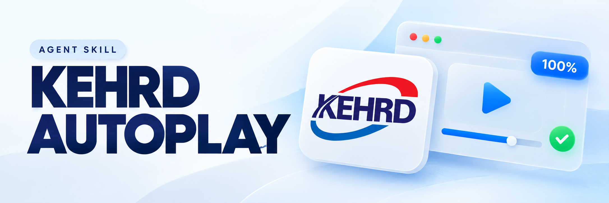
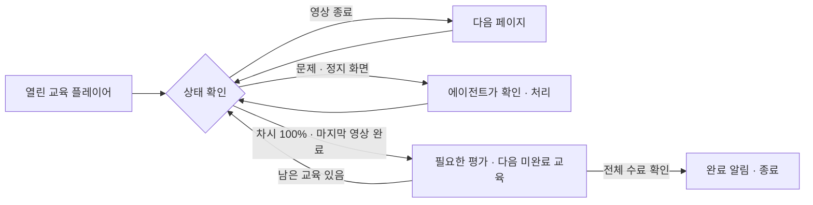

<div align="center">



# KEHRD Autoplay

**교육 영상은 순서대로, 중간 문제는 에이전트와 함께.**

한국이러닝인재개발원(kehrd.com)의 열린 교육 플레이어를 감시하고,<br>
영상이 끝나면 다음 페이지로 이동하고, **기본으로 남은 차시·과정 전체**를 순서대로 이어가는 에이전트 스킬입니다.


[설치](#설치) · [바로 사용하기](#바로-사용하기) · [동작 방식](#동작-방식) · [직접 실행](#직접-실행)

</div>

---

## 할 수 있는 일

| 기능 | 동작 |
| --- | --- |
| 영상 자동 진행 | 재생 시간과 페이지 번호를 확인하고 영상이 끝났을 때 다음 페이지로 이동 |
| 진도율 확인 | 기본은 100% 이후 다음 미완료 교육으로 이동, 현재 차시만 지정하면 종료 |
| 전체 과정 진행 | 차시 100% → 필요한 평가 처리 → 다음 차시 → 다음 미수료 과정 |
| 중간 문제 처리 | 문제를 감지하면 실행 중인 에이전트가 지문·보기를 읽고, 요청받은 문제 풀이 진행 |
| 정지 화면 확인 | 재생 정지·대화상자·알 수 없는 화면에서 에이전트가 상태 확인 |
| macOS 알림 | 완료 또는 화면 확인이 필요할 때 시스템 알림 요청 |
| 중복 실행 방지 | 같은 상태 폴더를 사용하는 감시기의 중복 실행 차단 |

> **문제·평가 풀이는 에이전트가 담당합니다.** 감시 스크립트만 실행하면 문제나 평가 감지 시 종료됩니다. 답변하고 학습을 이어가려면 Codex 또는 Claude Code가 작업을 계속 실행하고 있어야 합니다.

## 설치

먼저 `ego-browser` CLI와 해당 에이전트용 ego-browser 스킬, Python 3를 준비하세요. 브라우저에서 KEHRD에 로그인하고 교육 플레이어를 열어둡니다.

**Codex**

```bash
mkdir -p "$HOME/.codex/skills"
git clone https://github.com/nathankim0/kehrd-autoplay-skill.git \
  "$HOME/.codex/skills/kehrd-autoplay"
```

**Claude Code**

```bash
mkdir -p "$HOME/.claude/skills"
git clone https://github.com/nathankim0/kehrd-autoplay-skill.git \
  "$HOME/.claude/skills/kehrd-autoplay"
```

설치 후 새 에이전트 세션에서 사용하세요. 이미 설치했다면 해당 폴더에서 `git pull --ff-only`로 업데이트할 수 있습니다.

## 바로 사용하기

Codex에서는 스킬 이름을 지정합니다.

```text
$kehrd-autoplay로 교육 진행해줘.
```

Claude Code에서는 `/kehrd-autoplay`를 호출하거나 같은 내용을 자연어로 요청합니다. 공간과 페이지를 알고 있다면 함께 알려주세요.

```text
TaskSpace 1의 p1은 과정 상세, p2는 플레이어야. 교육 진행해줘.
```

“전부”라고 덧붙이지 않아도 남은 차시·과정과 필요한 문제·평가를 이어가며 전체 수료 후 알려줍니다. 현재 차시만 진행하려면 그 범위를 명시하세요.

## 동작 방식



감시기는 약 10초마다 화면을 확인합니다. 짧은 감시 라운드를 이어서 실행하며, 문제나 확인이 필요한 화면에서는 종료해 에이전트가 이어받도록 합니다.

기본으로 다음 차시와 과정으로 이어갑니다. 현재 차시만 명시적으로 요청한 경우에만 100%에서 멈춥니다. 일반 법정교육은 100% 자동 수료 여부를 확인하고, 산업안전보건교육은 차시별 평가 합격 등 화면에 표시된 수료 조건까지 확인합니다. 사이트가 요구하는 순서와 학습시간을 지키며, 잠금을 우회하거나 진도 데이터를 직접 수정하지 않습니다.

## 직접 실행

저장소 폴더에서 실행합니다. `--space`와 `--page`는 실제 열린 플레이어 값으로 바꾸고, 상태 폴더는 교육 세션마다 새로 지정하세요.

```bash
# macOS: 감시가 실행되는 동안 절전 방지
caffeinate -dimsu python3 scripts/watch.py \
  --space 1 --page p2 --state-dir /private/tmp/kehrd-session
```

Linux에서는 `caffeinate -dimsu`를 빼고, 상태 폴더를 `/tmp/kehrd-session` 등으로 지정합니다. Windows는 지원하지 않습니다.

**전체 진행이 기본값**입니다. 상세 페이지는 기본 `p1`이며, 다른 탭이라면 `--playlist-page p3`처럼 지정합니다. 특정 과정만 요청했다면 에이전트가 그 범위 안에서 전환을 관리합니다.

**현재 차시만 진행**하려면 다음 옵션을 명시합니다.

```bash
caffeinate -dimsu python3 scripts/watch.py \
  --space 1 --page p2 --current-lesson-only \
  --state-dir /private/tmp/kehrd-one-lesson
```

기본 실행에서는 차시가 100%가 되고 마지막 영상까지 끝나면 플레이어를 종료하고 다음 미완료 차시를 엽니다. 모든 차시를 마치면 내강의실 목록에서 다음 미수료 과정을 찾습니다. 평가나 잠금 해제가 필요하면 에이전트가 처리한 뒤 이어가며, 목록 전체의 수료를 확인하면 종료합니다. 알 수 없는 수료 상태에서는 완료로 판단하지 않습니다.

| 상태 파일 | 의미 |
| --- | --- |
| `progress.log` | 페이지·재생 시간·진도율 기록 |
| `latest.snapshot` | 가장 최근에 관찰한 화면 |
| `runner.log` | 브라우저 실행 출력과 알림 오류 |
| `QUESTION` | 문제·정지·대화상자·오류 등 화면 확인 필요 |
| `DONE` | 단일 차시 100% 또는 전체 과정 수료 확인 화면 |
| `player.json` | 전체 모드에서 현재 플레이어의 페이지 라벨 |
| `playlist.json` | 전체 모드에서 확인한 과정별 수료 상태 |
| `lesson-completed.snapshot` | 가장 최근에 100%를 달성한 차시 화면 |
| `watch.lock` | 같은 상태 폴더의 중복 실행을 막는 잠금 |

종료 코드 **0**은 완료, **2**는 화면 확인 필요, 그 외는 실행 오류입니다. `QUESTION`이 생기면 에이전트가 실제 화면을 확인하고 원인을 처리한 뒤 해당 파일을 삭제해 같은 명령을 다시 실행합니다. 평가 후 새 플레이어를 열었다면 `player.json`도 새 페이지 라벨로 갱신합니다. `DONE`이 있는 폴더에서는 새 교육을 시작하지 않습니다.

상태 파일에는 학습 화면의 개인정보가 포함될 수 있으므로 저장소 밖의 로컬 폴더에 보관하세요. 시스템 알림 표시는 macOS 알림 설정에 따라 달라질 수 있습니다.

## 검증과 구성

```bash
node scripts/test-watch.mjs
node scripts/test-playlist.mjs
python3 -m py_compile scripts/watch.py
```

동작 검증은 100%·문제 감지, 영상 종료 전 이동 방지와 페이지 이동, 차시·과정 전환, 평가 대기, 잠긴 과정·알 수 없는 상태의 중지를 확인합니다. 실제 사이트의 전체 교육 과정을 대신 검증하지는 않습니다.

| 파일 | 역할 |
| --- | --- |
| [SKILL.md](SKILL.md) | 에이전트의 실행·문제 풀이·복구 절차 |
| [scripts/watch.py](scripts/watch.py) | 감시 라운드 실행·잠금·종료 알림 |
| [scripts/watch.mjs](scripts/watch.mjs) | ego-browser로 플레이어 상태 확인·페이지 이동 |
| [scripts/playlist.mjs](scripts/playlist.mjs) | 다음 차시·과정 전환과 전체 수료 확인 |
| [scripts/test-watch.mjs](scripts/test-watch.mjs) | 모의 화면으로 감시 동작 검증 |
| [scripts/test-playlist.mjs](scripts/test-playlist.mjs) | 모의 내강의실로 전체 진행 동작 검증 |

플레이어의 화면 구조가 바뀌면 파싱과 문제 감지를 조정해야 합니다. 영상·캔버스 내부의 문제는 재생 정지 시 에이전트가 스크린샷으로 확인합니다.

대문 이미지는 [KEHRD 공식 아이콘](https://kehrd.com/img/favicon.ico)을 참고해 ImageGen으로 제작했습니다. [생성 프롬프트](assets/cover-prompt.txt)
